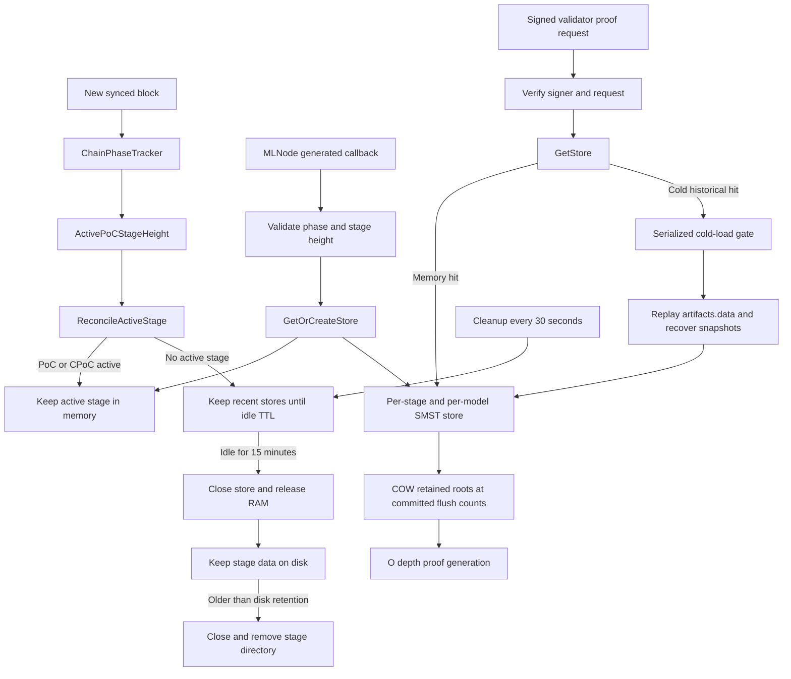
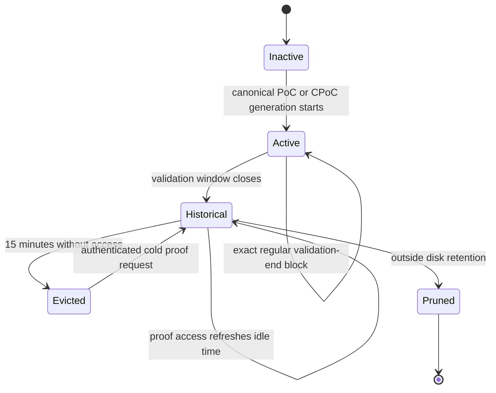

# PoC artifact store lifecycle

This package stores generated PoC artifacts, commits SMST roots, and serves
inclusion proofs for regular PoC and confirmation PoC (CPoC).

The lifecycle manager separates two retention concerns:

- Memory retention keeps only stores needed for active work or recent proofs.
- Disk retention preserves recent stages so a store can be recovered after a
  restart or memory eviction.

## Current flow

## Lifecycle state

The active stage is derived from canonical chain state on every synced block.
Regular PoC remains active through the inclusive validation-end block, even
though the chain phase label changes to inference at that exact height. CPoC is
active only while its event is in generation or validation.

When a stage becomes active, all other open stages are evicted from memory.
When no stage is active, historical proof requests may recover stores from
disk.

## Store and snapshot behavior

Each `(stage height, model ID)` has an independent `SMSTArtifactStore`.
Model IDs are path-escaped and empty, `.` and `..` identifiers are rejected.

The store writes:

- `artifacts.data`: append-only nonce and vector records.
- `distributions.jsonl`: node distribution snapshots.
- `flushed_roots.jsonl`: durable committed counts and SMST roots.

With the default configuration:

- `SMST_COW=1` preserves committed roots by copying only the changed
  root-to-leaf path.
- `SMST_DEFERRED_HASH=1` computes hashes when a root or proof needs them.
- `SMST_PARALLEL_HASH=1` fills independent hash subtrees in parallel.
- A flush captures a retained snapshot for its committed count.
- Restart recovery replays `artifacts.data` once and re-captures committed
  snapshots from `flushed_roots.jsonl`.
- A hot retained snapshot serves historical proofs in `O(depth)`.
- A non-committed count is rejected and cannot trigger a rebuild.

`SMST_COW=0` is a profiling and compatibility path. It depends on deep clones
or the process-wide snapshot rebuild cache and may perform `O(N)` replay work.

## Enforced limits

Memory lifecycle:

- Historical stage idle TTL: 15 minutes.
- Maximum resident historical stage heights while inactive: 2.
- Cleanup interval: 30 seconds.
- Concurrent cold store recoveries: 1.
- Concurrent cold requests wait, then re-check the cache and lifecycle policy.

Disk lifecycle:

- `retainCount` controls how many stage directories remain on disk.
- Production currently passes `retainCount=10`.
- Pruning and cold recovery share the same gate so they do not open and remove
  a stage concurrently.

Proof serving:

- Maximum requested leaf indices or nonces per proof request: 500.
- Proof and artifact-state endpoints allow 300 requests per minute per IP with
  burst 30.
- The unauthenticated artifact-state endpoint serves only the active stage.
- Historical proof loading happens only after validator signer and request
  verification.

SMST and fallback cache:

- Maximum artifacts in one SMST store: 1,073,741,823.
- Process snapshot cache entries: 6.
- Unpinned process snapshot cache idle TTL: 20 minutes.
- Concurrent legacy snapshot rebuilds: 2.

These are count limits, not byte limits. Vector size, tree shape, Go object
overhead, and retained COW paths determine actual RAM use.

## Failure handling

- A callback with the wrong stage height is rejected before storage.
- Store acquisition and artifact write failures return HTTP 503 to MLNode.
  MLNode can retry the batch; duplicate nonces are ignored.
- Cold requests wait behind at most one active recovery and reuse its result
  when they request the same stage and model.
- Closing a store attempts to close every file even if flush or another close
  operation fails.
- Snapshot rebuilds use an independent read handle, so store eviction does not
  invalidate an in-flight defensive rebuild.
- Closing a store purges its entries and rejects its in-flight process-cache
  build result.

## Known limitations

Cold recovery is still `O(N)` in artifact count and reconstructs the full SMST
in memory. The single-load gate prevents concurrent amplification, but it does
not cap the memory required by one large store.

Two large historical stages can remain resident when there is no active stage.
For a store that requires 11-14 GiB, the configured two-stage bound can retain
approximately 22-28 GiB, excluding cache and runtime overhead.

Sequential requests can rotate across three or more retained disk stages. The
serialized gate prevents concurrency, but it does not prevent repeated serial
recoveries and LRU eviction. Preventing this requires a policy decision:

- Restrict cold recovery to the latest two disk stages.
- Add a per-stage recovery cooldown or global recovery budget.
- Replace full recovery with a bounded on-disk proof index.

Eviction flushes every model store before detaching the stage. A flush failure
keeps the full stage resident for a later cleanup retry.

The legacy non-COW path remains intentionally available for compatibility and
profiling. Its rebuild cache bounds entry count and concurrent builders, but a
single rebuild remains `O(N)` and queued distinct committed counts can consume
work over time.
